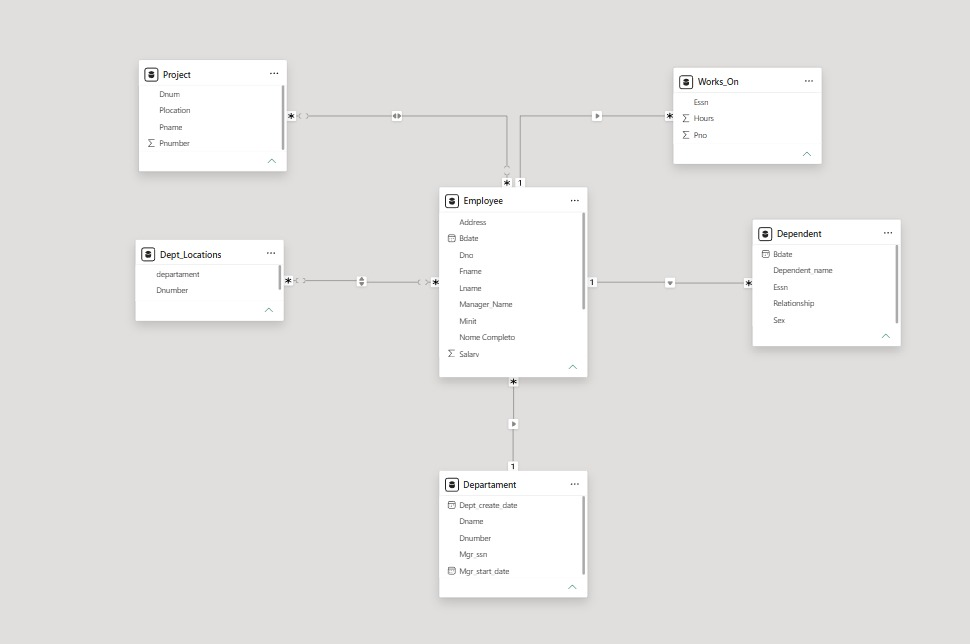

  
  <h1>People Analytics Dashboard</h1>
  
<strong>Azure Company | Projeto do Módulo 3</strong>

---

## Sobre o projeto

Este projeto de Business Intelligence transforma dados relacionais de Recursos Humanos da Azure Company em uma visão analítica para apoiar a compreensão da estrutura da equipe, dos custos salariais e da alocação de colaboradores em projetos.

O trabalho parte de uma base MySQL e reúne preparação de dados, modelagem no Power BI e construção de um dashboard executivo. O resultado foi pensado para facilitar a leitura dos principais indicadores e permitir a exploração dos dados por colaborador, departamento, projeto e localidade.

## Desafio de negócio

As informações de colaboradores, departamentos, dependentes, projetos e horas trabalhadas estavam distribuídas em diferentes tabelas. O desafio foi relacionar essas informações e apresentá-las de forma consistente, evitando ambiguidades e facilitando análises de pessoas e custos.

## Processo e soluções

### Preparação e transformação

- Inspeção da estrutura das tabelas e verificação de dados nulos.
- Ajuste do campo salarial para o tipo decimal, adequado a valores monetários.
- Tratamento de registros de gerentes e departamentos sem gerente atribuído.
- Tratamento de horas nulas nas alocações de projeto.
- Criação de consultas para consolidar nomes e relacionar colaboradores a departamentos e gestores.
- Uso de junções `LEFT JOIN` para preservar os colaboradores mesmo quando não há correspondência em uma tabela relacionada.

### Modelagem analítica

O modelo do Power BI organiza as entidades de colaboradores, departamentos, projetos, dependentes, localidades e alocações de horas. As relações conectam os dados de pessoas à estrutura organizacional e às iniciativas da empresa, dando suporte aos filtros e visuais do relatório.

### Expressões e métricas

O relatório apresenta indicadores de colaboradores, média salarial e projetos, além de medidas para analisar custos por departamento e a distribuição de pessoas. Para departamentos com mais de uma localidade, a medida `Locais_Departamento`, baseada em `CONCATENATEX`, reúne os locais em um único resultado e ajuda a evitar repetição de colaboradores em visuais tabulares.

## Dashboard

O painel reúne filtros por funcionário, departamento, projeto e localidade, além de indicadores e visuais para leitura executiva. Na captura abaixo, os valores apresentados são os do estado atual dos filtros: 8 colaboradores, média salarial de 35,13 mil e 6 projetos.

  

### O que pode ser analisado

- **Indicadores principais:** total de colaboradores, média salarial e total de projetos.
- **Custo salarial por departamento:** comparação dos custos entre Research, Administration e Headquarters.
- **Colaboradores por projeto:** visualização da quantidade de pessoas alocadas em cada iniciativa.
- **Distribuição por departamento:** participação de cada área no quadro de funcionários.
- **Tabela detalhada:** identificação, nome, gestor, sexo, data de nascimento, salário, departamento, horas e projetos por colaborador.
- **Filtros interativos:** exploração dos dados por funcionário, departamento, projeto e localidade.

## Modelo de dados

A imagem apresenta as tabelas e os relacionamentos utilizados no modelo do Power BI, com `Employee` conectada às informações departamentais e às tabelas de projetos, dependentes e localidades.

  

## Tecnologias utilizadas

- **Banco de dados:** MySQL
- **ETL:** Power Query (M)
- **Modelagem e medidas:** Power BI e DAX
- **Visualização:** Power BI
- **Consultas e preparação SQL:** MySQL

## Arquivos do projeto

- [`relatorio.pbix`](relatorio.pbix): arquivo do relatório Power BI.
- [`scrip_teste1.sql`](scrip_teste1.sql): consultas de inspeção, tratamento e relacionamento dos dados.
- [`Relatório.jpeg`](Relat%C3%B3rio.jpeg): captura do dashboard.
- [`ModeloExibicao.jpeg`](ModeloExibicao.jpeg): captura do modelo de dados.

## Como visualizar

1. Baixe ou clone este repositório mantendo os arquivos de imagem na mesma pasta do README.
2. Abra `relatorio.pbix` no Power BI Desktop para explorar o relatório e seus filtros.
3. Consulte `scrip_teste1.sql` para ver as consultas usadas na preparação e validação dos dados.

## Aprendizados

O desenvolvimento deste projeto permitiu praticar a preparação de dados, o uso de junções SQL, a construção de relacionamentos no Power BI e a criação de indicadores para um contexto de People Analytics. Também reforçou a importância de considerar a granularidade dos dados e o efeito dos relacionamentos sobre os resultados dos visuais.
