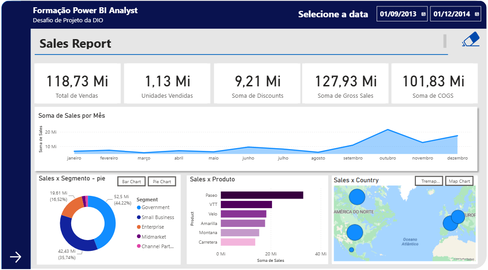

# Sales Management Report | Power BI


Dashboard financeiro e de vendas desenvolvido durante a **Formação Power BI Analyst da DIO (Digital Innovation One)**. O projeto transforma a base *Financial Sample* em uma experiência interativa para acompanhar receita, volume, descontos e lucratividade por diferentes dimensões do negócio.

> **Acesse o relatório publicado:** [Sales Management Report no Power BI Service](https://app.powerbi.com/view?r=eyJrIjoiNjUzZDY5MGUtMjQwMS00MDlmLWFhOGUtYjk5YmM4NzA3NWViIiwidCI6IjQwYmEzNmQ5LTQ0YmEtNGE0Ni1iM2FjLTIxYjFlMGQ0YzE5YiJ9)



## Visão executiva

O relatório foi estruturado para responder rapidamente perguntas como:

- Qual é o desempenho de vendas ao longo do tempo?
- Quais produtos, países e segmentos concentram a receita?
- Como descontos e custos impactam o resultado?
- Onde estão as maiores oportunidades de margem?

## Principais indicadores

| Indicador | Resultado |
| --- | ---: |
| Total de vendas | **$118,73 Mi** |
| Unidades vendidas | **1,13 Mi** |
| Descontos concedidos | **$9,21 Mi** |
| Vendas brutas | **$127,93 Mi** |
| COGS | **$101,83 Mi** |
| Lucro total | **$16,89 Mi** |

## Páginas do relatório

### Sales Report

Visão geral do desempenho comercial com análise de vendas por mês, segmento, produto e país. Os indicadores de vendas, unidades, descontos, vendas brutas e COGS ficam disponíveis para uma leitura rápida do negócio.

### Profit Analysis

Análise detalhada de lucratividade com comparação anual, distribuição por país e segmento, rentabilidade por produto e evolução trimestral em gráfico de cascata.

## Destaques analíticos

- O lucro acumulado analisado é de **$16.893.702,26**.
- O resultado evolui de **$3.878.464,51 em 2013** para **$13.015.237,75 em 2014**.
- O segmento **Government** aparece como um dos principais geradores de margem.
- A navegação entre as páginas e os filtros facilita a exploração por período, região, produto e segmento.

## Competências demonstradas

- Construção de dashboards executivos no Power BI.
- Modelagem e exploração de dados financeiros e comerciais.
- Criação de medidas e indicadores com **DAX**.
- Desenvolvimento de análises temporais, geográficas e por categorias.
- Organização de layout, hierarquia visual e experiência de navegação.
- Publicação e compartilhamento de relatório no Power BI Service.

## Arquivos do projeto

```text
.
├── Financial Sample.xlsx              # Base de dados de origem
├── relatoriocriativo_projetoDIO.pbix # Arquivo-fonte editável do Power BI
└── Readme.md                          # Documentação do projeto
```

## Como explorar

1. Para visualizar o resultado, abra o [relatório publicado](https://app.powerbi.com/view?r=eyJrIjoiNjUzZDY5MGUtMjQwMS00MDlmLWFhOGUtYjk5YmM4NzA3NWViIiwidCI6IjQwYmEzNmQ5LTQ0YmEtNGE0Ni1iM2FjLTIxYjFlMGQ0YzE5YiJ9).
2. Para estudar a implementação, abra `relatoriocriativo_projetoDIO.pbix` no **Power BI Desktop**.
3. Caso a fonte precise ser atualizada, utilize `Financial Sample.xlsx` e revise os caminhos das consultas no Power Query.

## Contexto do desafio

Este projeto atende ao desafio prático da formação, que propõe criar um relatório mais elaborado a partir da *Sample Financial*, utilizando estrutura de páginas, botões de navegação, segmentadores e publicação no Power BI Service. O resultado também funciona como uma demonstração prática de competências para oportunidades em **Business Intelligence, Data Analytics e Reporting**.

## Créditos

- Projeto desenvolvido por **Paulo Allan**.
- Desafio e trilha de aprendizagem: [DIO - Power BI Analyst](https://github.com/julianazanelatto/power_bi_analyst).
